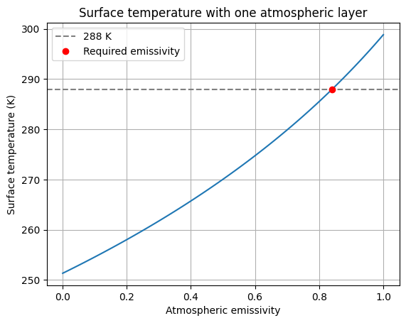
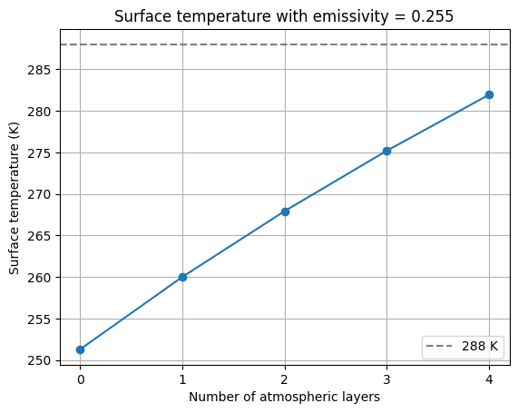
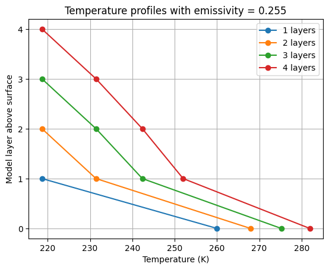
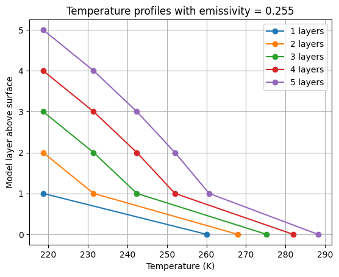
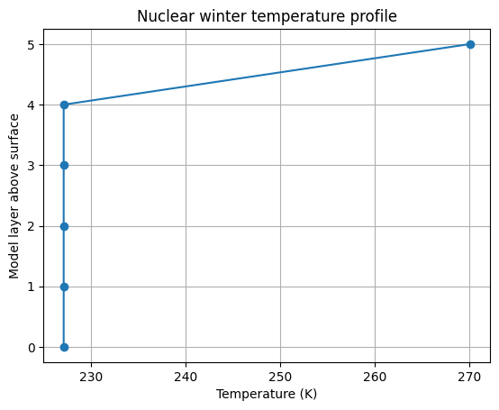

# Lab 3: Energy Balance Modelling
## Keira Slocum

## Overall Approach

### Task 1
For task 1, we create a model for the atmosphere in which a black body surface lies underneath multiple atmospheric layers of constant emissivity. To do this numerically, we needed to create a coefficient matrix (A) and an array (b) to represent the absorbed light. We then create a loop to iterate through a set number of layers that produced a energy balance equations at each interface with the upward and downward raditation. 

Given the output, 
"A:
[[ 1. -1.  0.]
 [ 0.  1. -1.]
 [ 0.  0.  1.]]
b:
[226.125 226.125 226.125]
Fluxes, W/m^2:
[678.375 452.25  226.125]"

For the two perfectly absorbing layers, our model ouput the fluxes listed above for the surface, low layer, and upper layer of the model. This matches what we should expect given the theoretical background for the project as our surface emission was 3 times the absorbed sunlight, the low layer was 2 times as great, and the upper layer emitted the same amount as the sunlight absorbed. This is further supported by a series of validation assessments in the code. We can use numpy's built in testing functions to see if our output is equal to the output if our given parameters were calculated without matrices using the theoretical formulas.

### Task 2

I took the model from task 1 and applied it to a model function. The function takes the number of layers, solar flux, emissivity, and albedo and calculated an equation for each boundary interface for F0 (Surface) to our top layer (FN). We can then reuse our code from the task 1 model to find these equations and complete the matrix multiplication. Then to validate the code by using test parameters with a known output and use the numpy validation again to see if the model output is equal to the expected temperature.

Output: 
Temperatures in K, starting at the surface:
[330.72418084 298.84303245 251.29603471]
Validation passed.
Emissivity needed for 288 K: 0.8406819766901319
Surface temperature check: 288.0 K

### Task 3

For experiment 1, we produce 100 emissivity values between a small value above 0 and 1. The we loop through the single layer model for each of the values and plot the surface temperatures as seen below in figure 1. We can then solve to find the emissivity needed for a surface temperature of 288K. We can then use Figure 1 and plot the point along the line at 288K to find the associated emissivity on the x axis.

For the second experiment, emissivity was fixed at 0.255 and we varied the number of layers from 0-4. We then could call our model function and loop through all of the possible numbers of layers in the system and return their associated surface temperatures and plot temperature vs layer count in Figure 2. We then were able to create a plot that shows the progression of each case (layer number 0-4) through each of their layers as seen in Figure 3.

Experiment 1 output:

Figure 1: Emissivity in a One Layer Atmosphere Model

Experiment 2 Output:
"Layers: 0 Surface temperature: 251.3 K
Layers: 1 Surface temperature: 260.01 K
Layers: 2 Surface temperature: 267.93 K
Layers: 3 Surface temperature: 275.2 K
Layers: 4 Surface temperature: 281.94 "

Figure 2: Surface Temperature for 0-4 Layers

Figure 3: Layer Surface Temperature Profile

Figure 3.1: Modified Layer Surface Temperature Profile

**How does the surface temperature of Earth depend on emissivity and the number of layers ?**

The modeled surface temperature increases as the emissivity increases and as the number of atmospheric layers increases. We can see this in figure 1 as the single layer atmosphere requires an emissivity of about 0.84 to have a surface temperature of 288K. If we look back at our validation parameters, this value is much greater than the expected 0.255. In order to offset the lack of layers, the emissivity of the present layer increases. 

In figure 2, we can see that adding additional atmospheric layers also increases the surface temperature (as seen by the plot's curve) as all other model parameters are held constant. Surface temperature is shown to rise from ~250K in a no atmosphere model to >280K when there are four layers. This makes sense theoretivallt as additional layers absorb more incident infrared radiation and emit some downward to the layers below. 

**Using this emissivity value, how many layers of atmosphere are required to produce a surface temperature of ∼ 288K?** 

Using Figure 3, we can see that using four layers only gets us a value of ~282K as seen by the red line on the plot. Since this value is approaching 288, I decided to modify the code to plot a five layer atmosphere as seen in the modified figure 3.2. From the purple line, we can see that a five layer atmosphere for this model gets us approximately our desired temperature of 288K. 

### Task 4

For this task we could model venus by modifying our parameters to match venus'. First, we can rearrange the energy balance equatoon to solve for layer number. As seen in the ouput block below, we returned a value between 82 and 83 layers. Since layers must be an integer, we can run the model for the lower and upper limits to best characterize the region between. The best_temperature function indexes the surface temperature from all of our arrays and subtracts the target temperature of 700K to find out how far away we are from our desired number. Then, we can compare the two differences and select the better whole number layer count.

Task 4 output: "Estimated number of layers: 82.78086338461539
Closest whole number of layers: 83
Surface temperature: 700.4572804458084 K
Validation passed

**How many atmospheric layers do we expect on the planet Venus?**

As stated above, our model predicts that under these condtions Venus would have approximately 83 layers.

**How many perfectly absorbing layers do you need to match the surface temperature of Venus?**

With our emissivity set to 1 and our solar radiance set to 2600 W/m^2m we get an output surface temperature of 700.46K for an 83 layer model. This closely matches the desired value and passes our validation check in the code.

### Task 5

To approach task 5, we can first start by modifying our model function from task 2 to instead have the top layer N absorb all the sunlight remaining after the radiation reflects. This prevents sunlight from reaching the Earth's surface. I ran this new model with 5 layers, an emissivity of 0.5, a solar irradiance of 1350, and an albedo of 0.33 to get the following outputs. I also validated these results by checking that the fluxes fit the boundary equatuons and that the top layer temperature against a manually calculated value from a known function. I then plotted temperature against the number of layers in figure 4 below.

Task 5 Output: 
"Surface temperature: 227.07160046369086 K
Temperatures from surface to top layer:
[227.07160046 227.07160046 227.07160046 227.07160046 227.07160046
 270.03516289]
Temperature validation passed"

Figure 4: Nuclear Temperatures

**What would the Earth’s surface temperature be under a nuclear winter scenario?**

The nuclear model produces a much cooler surface. In figure 4, we can see that the surface and layers 1-4 have the same temperature whereas the top layer is much warmer as the profile line juts out to approximately 270K. This makes sense as the top layer can directly absorb incident sunlight but the layers below are blocked.

**What is the resulting surface temperature (of using 5 layers with emissivity = 0.5)**

As stated above, a 5 layer emissivity =0 0.5 model results in a surface temperature of approximately 227K. This is much colder than normal and would probably result in catastrophic impacts on human civilizations.
